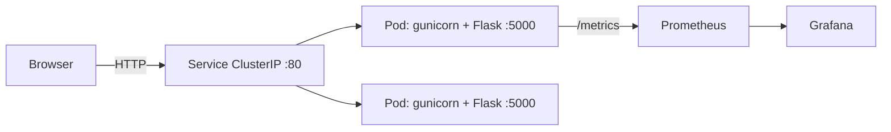

# DevOps Task Tracker (Project 1 of 3: one-tier)

A small Flask web app (UI + REST API in one container) used as the hands-on target for a full DevOps pipeline:
**GitHub -> Jenkins -> Docker -> Amazon ECR -> Helm -> Kubernetes (EKS) -> Prometheus/Grafana**, across **DEV / QA / PROD**.

> **Verification status (read this first).** Executed and passing in the authoring sandbox: the 23 pytest cases' logic against Flask 3.1.3
> (using a throw-away stand-in for `prometheus_client` and a mini pytest shim, because that sandbox had no network), shell syntax checks, YAML/JSON parsing.
> **Not executed anywhere yet:** `pip install`, real `pytest`/`flake8`, `docker build`, `helm lint/template`, Jenkins, AWS, EKS, Prometheus, Grafana.
> Run the commands below yourself and trust only what *your* terminal prints.

## 1. What it does and why one tier
Create, edit, complete, and delete tasks in a dashboard with health, version and environment indicators. Flask serves the HTML/CSS/JS **and** the JSON API from one process; there is no database and no separate frontend, so there is exactly one thing to build, ship, and monitor. Project 2 adds PostgreSQL; Project 3 splits frontend/backend/database.

**Limitation (important):** tasks live in process memory. They vanish on restart/redeploy/pod replacement, and **each replica has its own separate memory** -
with 2 PROD replicas, refreshing the page may show different task lists. That is expected here and is the motivation for Project 2.
Gunicorn runs **1 worker + 4 threads** for the same reason (several workers would each hold different data).

## 2. Request flow


## 3. Folder structure
| Path | Purpose |
|---|---|
| `app.py` | Flask app: API, validation, health/ready, Prometheus metrics, in-memory store |
| `static/` | `index.html`, `style.css`, `app.js` (vanilla JS dashboard, dark/light) |
| `tests/test_app.py` | pytest suite (23 cases) |
| `requirements*.txt` | runtime / dev deps (pytest, flake8, bandit, pip-audit) |
| `Dockerfile`, `.dockerignore` | non-root Gunicorn image with HEALTHCHECK |
| `Jenkinsfile` | 17-step CI/CD pipeline |
| `helm/devops-task-tracker/` | chart; `values.yaml` + `values-dev/qa/prod.yaml`; templates: deployment, service, serviceaccount, servicemonitor, `_helpers.tpl` (required by Helm helpers) |
| `k8s/namespace-*.yaml` | the three namespaces (with Pod Security labels) |
| `monitoring/` | kube-prometheus-stack values + alert rules, Grafana dashboard JSON |
| `scripts/` | `local-test.sh`, `docker-build.sh`, `smoke-test.sh` (extra: used by Jenkins after each deploy) |
| `docs/` | architecture, deployment guide, troubleshooting |

## 4. API
| Method & path | Result |
|---|---|
| `GET /` | web UI |
| `GET /health`, `GET /ready` | JSON status (+ version, environment) |
| `GET /api/tasks` | `{tasks:[...], summary:{total,pending,completed}}` |
| `POST /api/tasks` | 201 task; 400 on invalid input |
| `PATCH /api/tasks/<id>` | 200 task; 400 invalid; 404 unknown |
| `DELETE /api/tasks/<id>` | 204; 404 unknown |
| `GET /metrics` | Prometheus text: `http_requests_total`, `http_request_duration_seconds`, `app_info`, `tasks_total` |

Config (env vars): `APP_ENV` (DEV/QA/PROD), `APP_VERSION`, `PORT`, `LOG_LEVEL`. No secrets are used or exposed.

## 5. Local development  *(WSL Ubuntu, from the project root)*
```bash
bash scripts/local-test.sh        # venv + flake8 + pytest. Expect: "LOCAL CHECKS PASSED"
source .venv/bin/activate && APP_ENV=DEV python app.py   # dev server on http://localhost:5000
```
*(Windows PowerShell users: run the same inside WSL; activate with `.venv\Scripts\Activate.ps1` only if you use native Windows Python.)*

## 6. GitHub setup  *(WSL Ubuntu)*
```bash
git init && git add . && git commit -m "Project 1: DevOps Task Tracker"
git branch -M main
git remote add origin https://github.com/<you>/devops-task-tracker.git && git push -u origin main
```
Never commit `.env`, kubeconfigs, `*.pem`, or Terraform state (all in `.gitignore`).

## 7. Docker  *(WSL Ubuntu with Docker)*
```bash
docker build -t devops-task-tracker:1.0.0 .
docker run --rm -p 5000:5000 -e APP_ENV=DEV devops-task-tracker:1.0.0
```
Verify from a second terminal: `curl localhost:5000/health` (expect `"status":"healthy"` and `"environment":"DEV"`), `curl localhost:5000/ready`, `curl localhost:5000/metrics | head`, then open http://localhost:5000.
Or run `bash scripts/docker-build.sh` to do all of it and check the container health state.
Troubleshooting: see `docs/troubleshooting.md`.

## 8. Environments (DEV / QA / PROD)
One chart, one image, three Helm releases in three namespaces; only the values file differs (`APP_ENV` is set from `environment:`).
| | DEV | QA | PROD |
|---|---|---|---|
| Namespace | task-tracker-dev | task-tracker-qa | task-tracker-prod |
| Replicas | 1 | 1 | 2 |
| Resources | base | base | higher requests/limits |
| Gate | auto after tests | auto after DEV smoke | **manual approval** |

> **Honest isolation note:** namespaces on one cluster are *logical* separation only (shared nodes, shared control plane, shared kernel).
> Production-grade isolation needs separate clusters or AWS accounts, network policies, and tighter IAM. This project does not claim otherwise.

**Local cluster test** (kind / minikube / Docker Desktop Kubernetes; *Kubernetes terminal*; no ECR needed):
```bash
docker build -t devops-task-tracker:1.0.0 .
kind load docker-image devops-task-tracker:1.0.0        # minikube: minikube image load ...
kubectl apply -f k8s/
helm upgrade --install task-tracker helm/devops-task-tracker -n task-tracker-dev -f helm/devops-task-tracker/values-dev.yaml
kubectl -n task-tracker-dev rollout status deploy/task-tracker-devops-task-tracker
kubectl -n task-tracker-dev port-forward svc/task-tracker-devops-task-tracker 8080:80     # then http://localhost:8080
```
On EKS the same chart is used with `--set image.repository=<ecr-uri> --set image.digest=sha256:...` (the pipeline does this).
For PROD on a tiny local cluster set `--set replicaCount=1`.

## 9. Helm cheat-sheet  *(Kubernetes terminal)*
```bash
helm lint helm/devops-task-tracker -f helm/devops-task-tracker/values-prod.yaml          # expect: 0 chart(s) failed
helm template task-tracker helm/devops-task-tracker -f helm/devops-task-tracker/values-prod.yaml   # render YAML
helm upgrade --install task-tracker helm/devops-task-tracker -n task-tracker-qa -f helm/devops-task-tracker/values-qa.yaml
kubectl -n task-tracker-qa rollout status deploy/task-tracker-devops-task-tracker
kubectl -n task-tracker-qa logs -l app.kubernetes.io/name=devops-task-tracker --tail=50 -f
helm history task-tracker -n task-tracker-qa && helm rollback task-tracker 1 -n task-tracker-qa     # rollback
helm uninstall task-tracker -n task-tracker-qa
```
Services are `ClusterIP`; use port-forward for testing and add an Ingress/ALB later with proper auth. No NodePort.

## 10. CI/CD, AWS, monitoring
- Jenkins, IAM, ECR, EKS, VPC design, ports, **costs and cleanup**: `docs/deployment-guide.md` and `docs/architecture.md`.
- Pipeline: tests -> flake8/helm lint -> bandit + pip-audit -> build -> Trivy -> ECR push -> **resolve digest** -> DEV -> smoke -> QA -> verify -> **manual approval** -> PROD (same digest) -> rollout verify. Any failing stage stops the run and archives diagnostics.
- Monitoring: install kube-prometheus-stack (this **does** install the Prometheus Operator) with `monitoring/prometheus-values.yaml`, then deploy the app with `--set serviceMonitor.enabled=true`. Import `monitoring/grafana-dashboard.json`. Keep Grafana on ClusterIP and use port-forward; admin password lives in a Kubernetes Secret you create by hand.

Useful PromQL:
```
sum(rate(http_requests_total[5m])) by (endpoint)
sum(rate(http_requests_total{status=~"5.."}[5m])) / sum(rate(http_requests_total[5m]))
histogram_quantile(0.95, sum by (le) (rate(http_request_duration_seconds_bucket[5m])))
kube_deployment_status_replicas_available / kube_deployment_spec_replicas
```

## 11. Security notes
Non-root user (UID 10001), read-only root filesystem, dropped capabilities, seccomp RuntimeDefault, no service-account token mounted, input validation with length limits, UI uses `textContent` (no HTML injection), no secrets in Git, IAM roles instead of keys, immutable digests for releases, image and dependency scans in CI. Jenkins and Grafana must not be public.

## 12. Not included yet
A **Terraform module** for the AWS resources is *not* included in this delivery (it could not be validated here). `docs/deployment-guide.md` lists the exact resources it would contain; ask for it as the next step.
